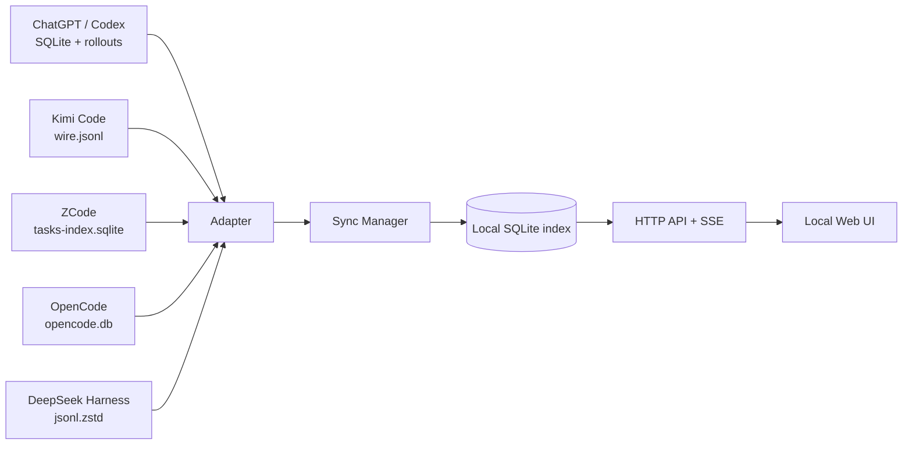

# AgentHub · 聚合智能体会话中枢

把分散在不同 AI 编码 Agent 里的会话、项目与日志，收进一个**本地、只读、可搜索**的统一面板。

ChatGPT / Codex、Kimi Code、ZCode、OpenCode、DeepSeek Harness 各自使用不同的目录结构：JSONL、SQLite、压缩事件流、文本索引。AgentHub 在本机读取这些数据，归一成统一的会话与消息模型，再用一个轻量 Web UI 呈现。

> **隐私边界**：不上传会话，不调用模型 API，不修改任何 Agent 的历史文件。仓库本身不包含会话数据、索引数据库、截图或本机路径配置。

---

## 功能

- **统一会话库**：跨 5 个 Agent 按时间浏览，支持来源、项目、归档状态筛选；首页活跃度图表可切换 7 天 / 21 天 / 90 天 / 全部历史。
- **全局搜索**：标题、项目路径、消息正文统一检索，`Ctrl/Cmd + K` 唤起命令面板。
- **项目归并**：按工作目录把不同 Agent 的会话合并到同一个项目。
- **会话回放**：用户消息、助手回复、思考过程、工具调用与命令输出分层展示。
- **实时跟随 + 子代理树**：详情页单独打开一条 SSE；Codex / OpenCode 的子会话按父子关系连接，列表用 `+N` 与缩进标识。
- **Agent 管理**：检测数据源、查看索引规模与最近扫描、单独重扫、暂停来源、打开原始目录。
- **继续命令**：为 Codex / Kimi / OpenCode 生成对应 CLI 的 resume 命令，一键复制。
- **本地优先**：Node.js 内置 SQLite 与 zstd，无数据库服务、无前端构建、无第三方运行时依赖。

---

## 支持的数据源

| Agent | 默认位置（Windows / macOS / Linux） | 格式 | 说明 |
|---|---|---|---|
| ChatGPT / Codex | `~/.codex/` | SQLite + JSONL | `state_5.sqlite` 的线程元数据 + `thread_history_1.sqlite` 的消息投影 |
| Kimi Code | `~/.kimi-code/` | JSONL | `sessions/*/session_*/state.json` 与 `agents/main/wire.jsonl` |
| ZCode | `~/.zcode/` | SQLite | `v2/tasks-index.sqlite` 及 `backup/*/tables.sqlite`，仅提供拼接文本 |
| OpenCode | `~/.local/share/opencode/opencode.db` | SQLite | 会话、消息、part 与工具调用 |
| DeepSeek Harness | `~/.dsh/` | JSONL + zstd | `sessions/*/session*.jsonl.zstd` 与项目缓存 |

`~` 在 Windows 上即 `%USERPROFILE%`。每个适配器只读打开源数据库；原作者、路径与格式保持不动。

---

## 快速开始

要求：**Node.js 24+**（使用 `node:sqlite`、`node:zlib` 的 zstd 支持）。

```bash
git clone https://github.com/never-die-cold/Aggregate-agent.git
cd Aggregate-agent
npm start
```

启动后自动打开 `http://127.0.0.1:5173`，首次会扫描全部来源并建立本地索引。索引保存在：

```
data/agenthub.db
```

该目录已被 `.gitignore` 排除。

常用命令：

```bash
npm run start:no-open   # 启动但不自动打开浏览器
npm run dev             # node --watch，修改服务端代码自动重启
npm run reindex         # 清空本地索引并全量重建
```

端口被占用时会自动向后寻找可用端口（5173、5174……）。也可以：

```bash
node server.js --port 8080
```

---

## 架构



### 目录

```
.
├── server.js                 # HTTP 服务、API、SSE、静态资源
├── lib/
│   ├── db.js                 # SQLite schema 与查询层
│   ├── sync.js               # 扫描、增量判断、归一化入库
│   ├── util.js               # 路径、时间、文本、项目键
│   └── adapters/
│       ├── index.js          # 适配器注册表
│       ├── common.js         # 只读 SQLite、文本提取
│       ├── codex.js
│       ├── kimi.js
│       ├── zcode.js
│       ├── opencode.js
│       └── dsh.js
├── public/
│   ├── index.html
│   ├── styles.css
│   ├── app.js                # 视图、路由、搜索面板、详情
│   ├── markdown.js           # 安全的 Markdown 渲染
│   └── favicon.svg
├── docs/ARCHITECTURE.md
├── package.json
└── start-agenthub.cmd
```

### 数据流

1. **扫描**：每个适配器输出 `SessionMeta[]`（标题、项目、时间、模型、token、源文件、fingerprint）。
2. **增量**：fingerprint 未变则跳过解析，只更新元数据；变了才重新读取消息。
3. **归一化**：不同来源的消息统一为 `user / assistant / tool / system` 与 `text / reasoning / tool / log / note`。
4. **索引**：会话元数据、消息、全文检索文本写入本地 SQLite；源文件保持只读。
5. **呈现**：HTTP API 提供列表、详情、项目、来源与统计；SSE 推送同步进度。

### 适配器接口

新增一个 Agent 只需要实现：

```js
export const adapter = {
  id: 'my-agent',
  name: 'My Agent',
  shortName: 'Mine',
  color: '#888888',
  glyph: 'M',
  roots: ['/path/to/data'],

  detect() {},                 // 数据目录是否存在
  scan() {},                   // 返回 SessionMeta[]
  load(meta) {},               // 返回 { messages, searchText, metaPatch }
  resumeCommand(meta) {},      // 可选：CLI 继续命令
  sourceFolder(meta) {},       // 可选：打开源目录
};
```

然后在 `lib/adapters/index.js` 中注册。`SessionMeta` 的核心字段与消息结构见 `docs/ARCHITECTURE.md`。

---

## 设计取舍

- **不做 Electron**：本地 Web 服务 + 浏览器即可，跨平台、启动快、容易审计。
- **不做云端索引**：会话是高度私密的工作记录，默认不离开本机。
- **不做写入**：当前版本不替 Agent 删除、归档或改写历史；只在 UI 内做筛选和展示。
- **不做重型前端**：无 React/Vite 构建步骤，直接由 Node 提供静态文件，降低维护成本。
- **保留原始格式**：适配器只读解析，不把源数据迁移到中心库，Agent 升级后仍可独立工作。

---

## 已知边界

- **ZCode** 的本地索引只提供拼接后的 `searchable_text`，没有逐条消息结构；详情页会明确标注“纯文本记录”。
- **ChatGPT** 读取的是 ChatGPT 桌面端 / Codex 的本地线程库，不包含 ChatGPT 网页版的云端历史。
- **Kimi** 读取 Kimi Code CLI 的本地 wire；Kimi 桌面端的云端会话不在本地，因而不在覆盖范围内。
- **OpenCode** 的数据库可能达到数 GB；首次索引会花一些时间，后续按 `time_updated` 增量。
- 目前没有 SSH / WSL 远程来源；所有数据源都来自本机。
- 会话中的图片、附件与 base64 内容不会完整索引，仅保留文本与工具摘要。

---

## 同类项目参考

- [Agent Viewer](https://github.com/Atituiset/agent-viewer) — Electron，多 Agent 会话浏览，支持 SSH/WSL、实时跟随和子 Agent 泳道。
- [Sessions Viewer](https://github.com/jerrywu001/cc-sessions-viewer) — Tauri，内置聊天/恢复、导出、成本统计与 Skills/MCP/Hooks 管理。
- [Agent Sessions](https://github.com/jazzyalex/agent-sessions) — macOS 原生，16 个 Agent、全文搜索、恢复与配额 burn rate。
- [AgentSessionManager](https://github.com/zhuchongba-01/AgentSessionManager) — Tauri，含 ZCode/DSH 的会话管理与安全清理。
- [kept](https://github.com/egroup-labs/kept) — 面向 ChatGPT / Claude / Gemini / Grok / Kimi 的本地归档与 MCP 回忆。
- [llm-deep-trace](https://github.com/userFRM/llm-deep-trace) — 编码 Agent 的会话浏览器、子 Agent 树与实时 tail。

AgentHub 的差异点：**无框架、无依赖的本地 Web 形态**，把“会话聚合”与“Agent 数据源管理”放在同一个面板，并且默认只读、零上传。

完整对比、功能矩阵与分阶段提升路线见 [docs/COMPARISON.md](docs/COMPARISON.md)。

---

## 开发

```bash
# 语法检查
node --check server.js
node --check public/app.js
node --check public/markdown.js

# 单独跑一个适配器
node -e "import('./lib/adapters/index.js').then(async ({adapters}) => { for (const a of adapters) console.log(a.id, (await a.scan()).length); })"
```

本仓库不会提交 `data/`、`tools/`、`*.db`、`*.png` 或任何本地运行产物；`.gitignore` 已覆盖。提交前可以用：

```bash
git status --short
git ls-files | Select-String -Pattern 'data/|tools/|\.db|\.png'
```

确认没有会话数据或截图进入版本库。

---

## License

MIT
